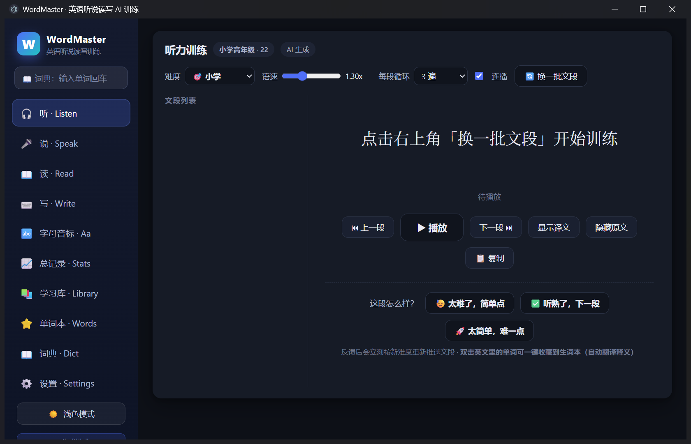
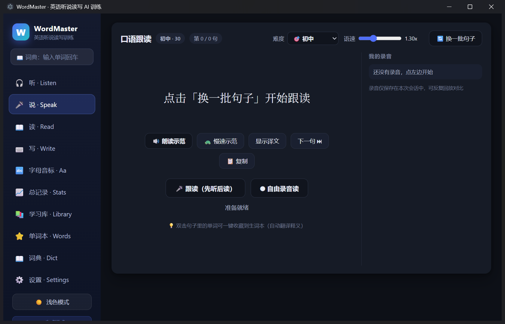
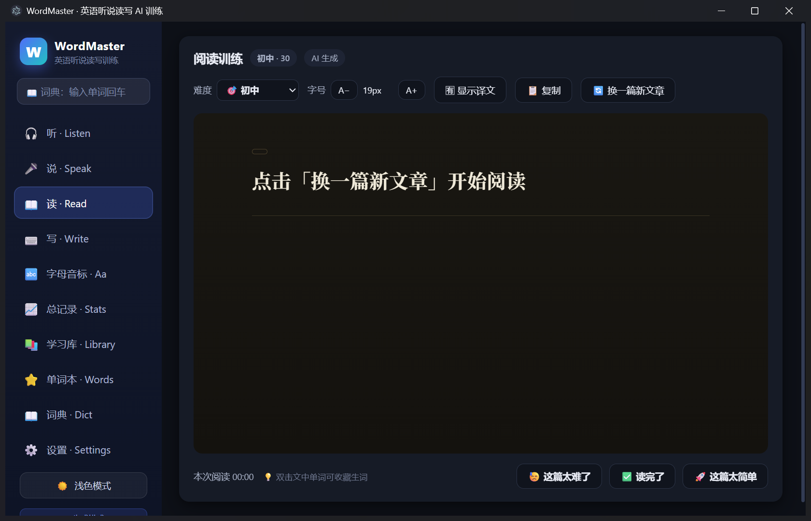
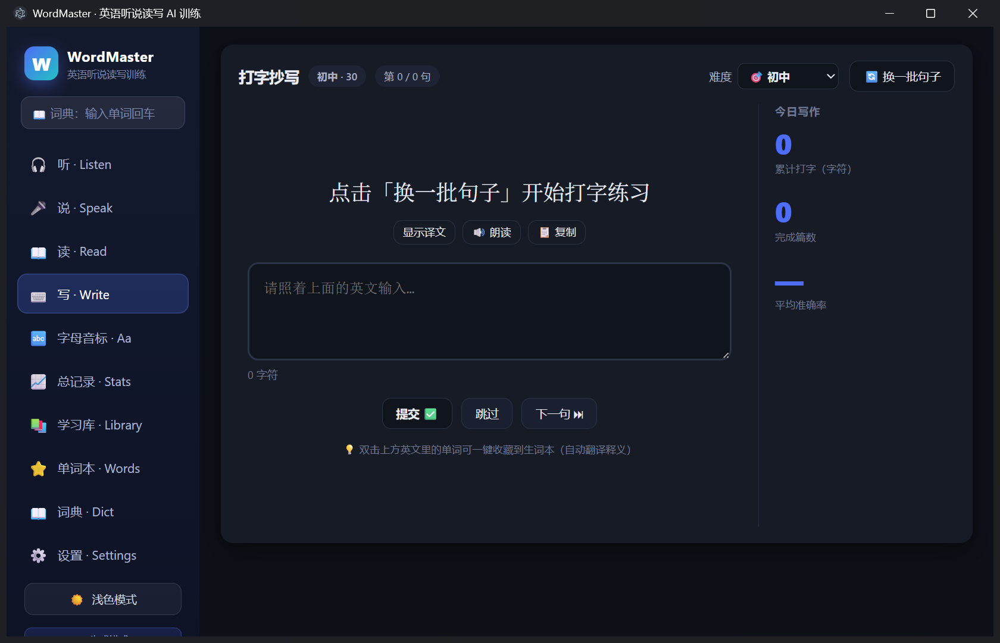
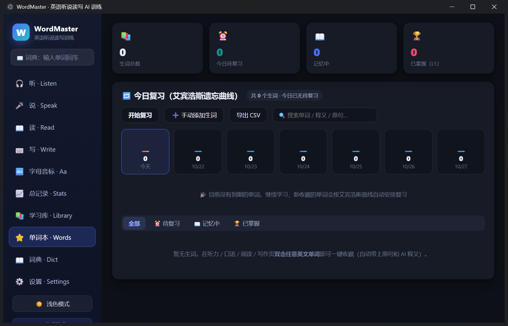
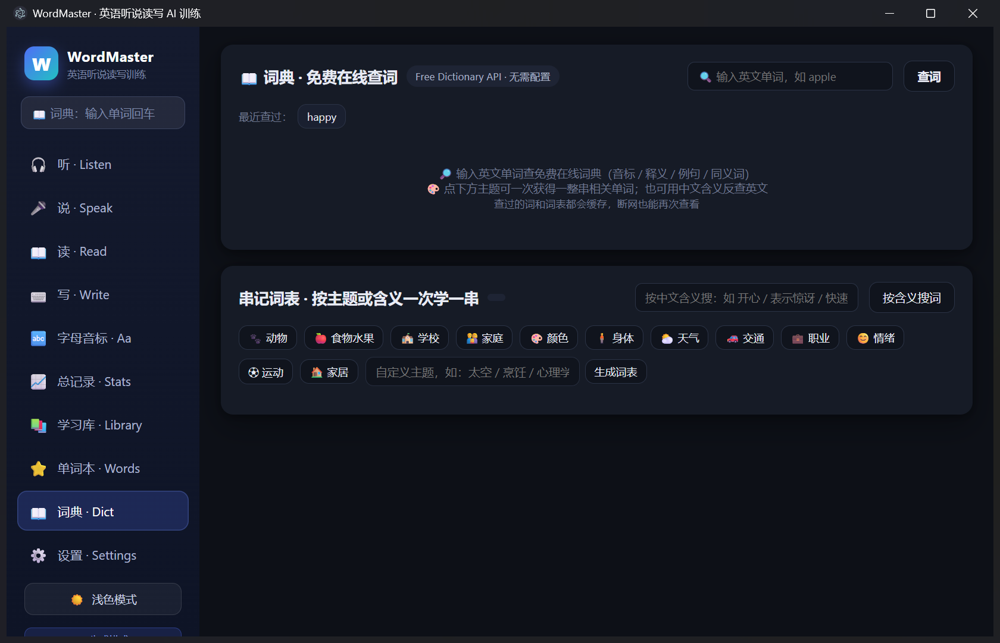
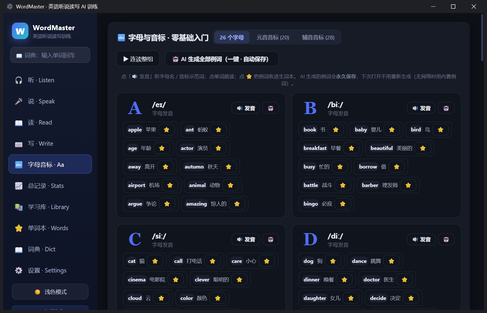
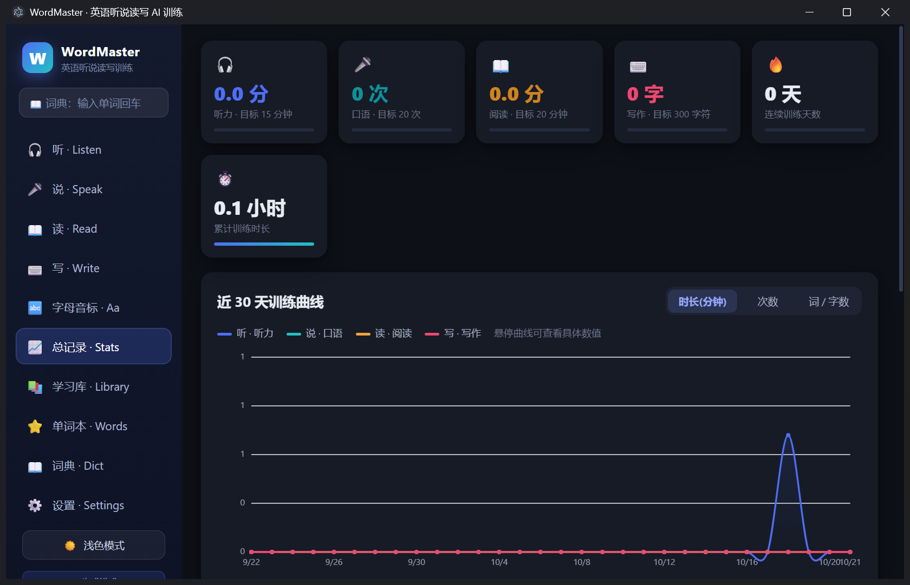

# WordMaster · 英语听说读写 AI 训练

**[English](#english) · [中文](#中文)**

> 离线优先的 Windows 英语训练桌面软件（Electron）。以 **听 · 说 · 读 · 写** 四路闭环训练为核心，
> 配合 AI 动态出题与难度自适应，让单位时间的有效训练量达到课堂式学习的五倍以上。
> 不填 API Key 也能用 —— 内置分层题库，断网可练。

| | | |
|---|---|---|
|  |  |  |
| **听 Listen** | **说 Speak** | **读 Read** |
|  |  |  |
| **写 Write** | **单词本 Words** | **词典 Dict** |

---

<a id="中文"></a>

## 📖 中文介绍

**WordMaster 是一款面向 Windows 的英语听说读写一体化训练软件**，用「听 → 说 → 读 → 写」四模块闭环 + AI 动态出题的方式做高强度日常训练，主打 **"五倍速"训练理念**：不靠报班和长期背单词书，而是每天在软件里按自己当前难度做高密度、可反馈、可复习的训练，让输入（听/读）和输出（说/写）同时发生。

- **不填 API Key 也能用**：内置小学 → 考研/雅思 六级分层题库，断网可练；配置 Key 后由 AI 按难度自动生成文段、句子和文章，生成失败自动降级回内置题库，**永远有内容可练**。
- **每个模块都带难度自适应**：点「太难了，简单点 / 太简单，难一点」立即按新难度重新推送，顶部也可一键切换 小学 / 初中 / 高中 / 大学 / 六级 / 考研·雅思。
- **练过的内容全部本地归档**，生词双击即收藏，按艾宾浩斯曲线自动安排复习。
- **完全离线优先**：训练记录、单词本、学习库全部存在本机，API Key 也只留在本地。

### 功能一览

#### 🎧 听 · Listen
- 按难度批量推送短文段（每段 ≤ 50 词），1/2/3 遍循环或连续循环，0.5x–1.5x 调速
- 盲听（隐藏原文）、显示/隐藏译文、一键复制英文
- 「太难了 / 太简单」即时微调难度（0–100），按新难度立即重推
- 自动记录每段播放时长与次数

#### 🎤 说 · Speak
- 句子 + 中文翻译，正常/慢速示范朗读，一键复制
- **跟读模式**：先播示范，播完自动录音，停 2 秒自动结束，带音量波形，可回放对比
- **自由录音**：手动起停，逐句记录录音次数

#### 📖 读 · Read
- 纸感排版：衬线字体、首字下沉、两端对齐，字号 14–30px 可调
- 一键切换中英对照排版；文章词数随级别增长（约 90 → 750 词）
- 阅读进度条、计时统计、一键复制；「太难/太简单」动态调整后续文章难度

#### ⌨️ 写 · Write
- 看英文句子/段落（可选译文）打字，逐字符对比：**绿=对 / 红=漏 / 橙=多**，给出相似度评分
- 自动统计每日打字字符数、篇数、平均准确率

#### ⭐ 单词本（生词收集 + 艾宾浩斯复习）
- 听/说/读/写任意页面**双击英文单词即收藏**，自动带上原句、原句译文和 AI 中文释义（释义可改）
- 按 1 / 2 / 4 / 7 / 15 / 30 天安排复习；闪卡把原句生词打码逼你回忆，点「忘了 / 模糊 / 记识」自动重排下次复习时间
- 7 天到期预览、待复习/记忆中/已掌握统计、全文搜索、导出 CSV

#### 🔤 字母音标（零基础入门）


- 26 字母 + 20 元音 + 28 辅音三组卡片：大字字形、IPA、发音要领、发音按钮
- 每个字母/音标配 ≥10 个练习单词（带中文），点词即读，可直接收藏
- 「AI 生成全部例词」结果永久存本地，断网用内置例词；「连读整组」自动连续朗读

#### 📖 词典（免费 · 无需配置）
- 侧边栏顶部常驻搜索框，输入单词回车即查
- Free Dictionary API：音标 IPA / 英文释义 / AI 中文翻译 / 例句 / 同义词，例句可朗读，同义词可再查
- 12 个预设主题串记词表（动物/食物/学校/家庭/颜色/身体/天气/交通/职业/情绪/运动/家居）+ 自定义主题，一次生成 20 词
- 支持按中文含义反查英文；查过的词全部缓存，离线可再看

#### 📚 学习库 + 📈 总记录


- 所有推送过的听力文段、口语句子、阅读文章、写作句子自动归档，可按模块/难度筛选、全文搜索、导出 TXT/JSON
- 近 30 天听说读写训练曲线、难度成长曲线、连续训练天数、明细表，可导出 CSV
- 每日目标：听力时长 / 口语次数 / 阅读时长 / 写作字符数，均可自定义

#### 🔊 朗读音色（三引擎）
1. **微软 Edge 神经语音（默认，推荐）**：联网拉取官方全部 322 款音色并智能分组（卡通童声/幽默活泼/情感丰富/中文含方言/各国口音），音调 -30%~+30% 变声；断网自动降级系统语音
2. 系统语音（离线可用）
3. AI 语音接口（OpenAI 兼容 `/audio/speech`，alloy/nova 等）

#### 其他
- 语速 0.5x–3x 无级调节；深色/浅色模式一键切换并记忆

### 快速开始

#### 方式一：免安装运行（推荐普通用户）
1. 拿到发布版后，解压 `win-unpacked` 文件夹
2. 双击 `WordMaster.exe` 即可使用，无需安装

#### 方式二：源码运行（开发者）
环境要求：Node.js 18+、npm。

```bash
# 进入项目目录
npm install
npm start
```

Windows 上也可直接双击 `启动WordMaster.bat`（首次会自动安装 Electron 依赖）。

### 使用方法（上手 3 步）

1. **选难度**：打开任意模块（默认「听」），右上角难度下拉选自己的水平（小学/初中/高中/大学/六级/考研·雅思），点「换一批文段」开始。
2. **做训练 + 即时反馈**：
   - 听：先盲听 2–3 遍，再「显示译文」「隐藏原文」对照；觉得难就点「太难了，简单点」，觉得简单点「太简单，难一点」。
   - 说：点示范句播放，播完跟着跟读，回放对比自己的发音。
   - 读：通读文章，可随时开中英对照；生词双击收进单词本。
   - 写：照着句子打字，看红绿橙订正，追求准确率。
3. **每日复习**：启动时「单词本」会提示今日待复习数量，按闪卡完成回忆；「总记录」页查看连续训练天数和 30 天曲线。

> 不配置 AI 时使用内置题库；想让题目更对胃口，在「设置」里填 Base URL、API Key、模型名，点「测试连接」即可。

### AI 配置（可选）

软件兼容任意 OpenAI 格式接口，在「设置」页填入：

| 服务商 | Base URL | 模型名 |
|---|---|---|
| OpenAI | `https://api.openai.com/v1` | `gpt-4o-mini` |
| DeepSeek | `https://api.deepseek.com/v1` | `deepseek-chat` |
| Kimi (Moonshot) | `https://api.moonshot.cn/v1` | `moonshot-v1-8k` |
| 通义（兼容模式） | `https://dashscope.aliyuncs.com/compatible-mode/v1` | `qwen-plus` |

> 建议用普通对话模型（deepseek-chat / gpt-4o-mini / qwen-plus）；推理型模型（deepseek-reasoner 等）会消耗大量 token 思考，容易截断内容。生成不稳定时，在设置里调低「每次生成数量」（阅读建议每次 1–2 篇）。

### 数据与隐私

- 训练记录与学习库保存在本机：`C:\Users\<你>\AppData\Roaming\WordMaster\wordmaster-data.json`
- 设置页支持导出 JSON 备份 / 导入 / 导出 CSV / 清空
- API Key 只保存在本机，请求由主进程直接发出，不上传任何服务器

### 从源码打包 exe（可选）

```bash
npm install electron-builder --save-dev
npm run dist
```

产物在 `dist/` 目录（NSIS 一键安装包 + 免安装目录）。

### 技术栈

- Electron 44 + 原生 HTML/CSS/JS（无前端框架）
- OpenAI 兼容 Chat Completions 出题；Free Dictionary API 免费词典
- 微软 Edge 神经语音 WebSocket TTS；系统 SpeechSynthesis；OpenAI 兼容 TTS
- 本地 JSON 文件持久化

---

<a id="english"></a>

## 📖 English Introduction

**WordMaster is an offline-first English training desktop app for Windows**, built around a closed loop of four integrated drills — **Listen → Speak → Read → Write** — plus AI-generated content that adapts to your level in real time. The goal is a **"5× speed" training philosophy**: instead of signing up for courses or grinding through word lists, you do high-density, immediately-feedbacked, auto-scheduled practice every day, so receptive skills (listening/reading) and productive skills (speaking/writing) happen at the same time.

- **Works without any API key**: a built-in six-level question bank (primary school → IELTS/TOEFL) works fully offline. Add a key and the AI generates passages, sentences and articles matched to your difficulty — and if generation fails it silently falls back to the built-in bank, so **there is always something to practise**.
- **Every module self-adapts**: hit "too hard, make it simpler" / "too easy, step it up" and new material is pushed at the new difficulty immediately; the level dropdown also switches between primary / middle / high school / university / CET-6 / IELTS-TOEFL in one click.
- **Everything you practise is archived locally**, and double-clicking any English word files it into a wordbook that schedules spaced-repetition reviews for you.
- **Privacy first**: training history, wordbook, library and your API key all stay on your own machine.

### Features

#### 🎧 Listen
- Batch-pushed passages (≤ 50 words each) matched to your level, with 1/2/3 replay loops or continuous playback, and 0.5x–1.5x speed control
- Blind listening (hide the original text), show/hide translation, one-click copy of the English
- Instant difficulty nudges ("too hard" / "too easy") on a 0–100 scale, re-pushing material instantly
- Automatic tracking of playback time and repeat count per passage

#### 🎤 Speak
- Sentence + Chinese translation, with normal-speed and slow-speed model readings, one-click copy
- **Shadowing mode**: plays the model first, then auto-records, auto-stops after 2 seconds of silence, shows a live waveform, and lets you replay for comparison
- **Free recording mode**: manual start/stop, recording count tracked per sentence

#### 📖 Read
- Paper-like typography: serif font, drop cap, justified text, adjustable 14–30px font size
- One-click bilingual layout; passage length grows with level (roughly 90 → 750 words)
- Reading progress bar, timer, one-click copy, and difficulty feedback that shapes later passages

#### ⌨️ Write
- Type the English sentence or passage (translation optional), compared character by character: **green = correct / red = missing / orange = extra**, with a similarity score
- Daily stats for characters typed, passages completed, and average accuracy

#### ⭐ Wordbook (collect + spaced repetition)
- **Double-click any English word** in Listen/Speak/Read/Write to collect it, automatically capturing the source sentence, its translation, and an AI-generated Chinese definition (editable)
- Reviews scheduled on the Ebbinghaus curve (1 / 2 / 4 / 7 / 15 / 30 days); flashcards blank out the target word in its original sentence to force recall, and "forgot / fuzzy / got it" reschedules the next review
- 7-day due forecast, pending / in-progress / mastered counters, full-text search, CSV export

#### 🔤 Phonics (zero-basis entry point)
- Three card groups — 26 letters, 20 vowels, 28 consonants — with large letterforms, IPA, pronunciation tips and a one-click speak button
- Every letter/phoneme carries ≥10 example words with Chinese meanings; click to hear, or collect straight into the wordbook
- "AI generate all example words" results are cached locally, so the built-in examples still work offline; "read the whole group" plays them back in sequence

#### 📖 Dictionary (free, zero configuration)
- A search box is always pinned to the top of the sidebar — type a word, hit Enter, done
- Free Dictionary API gives you IPA, English definitions, an AI Chinese translation, examples (readable) and synonyms (each re-searchable)
- 12 preset themed word lists (animals / food / school / family / colours / body / weather / transport / jobs / emotions / sport / home) plus custom themes, generating 20 words at a time
- Reverse lookup by Chinese meaning; every word you look up is cached for offline reuse

#### 📚 Library + 📈 Stats
- Every passage, sentence, article and writing prompt you have seen is archived, filterable by module and level, searchable, and exportable to TXT/JSON
- 30-day Listen/Speak/Read/Write curves, difficulty-growth curve, streak counter and a detailed log, exportable to CSV
- Daily goals for listening minutes, speaking reps, reading minutes and typed characters — all adjustable

#### 🔊 Three TTS engines
1. **Microsoft Edge neural voices (default, recommended)**: pulls all 322 official voices online and groups them intelligently (cartoon child, playful, emotional, Chinese dialects, world accents), with pitch shifting from -30% to +30%; falls back to system voices offline
2. System voices (fully offline)
3. AI speech API (OpenAI-compatible `/audio/speech`, alloy/nova and friends)

#### Extras
- Stepless 0.5x–3x speed control; one-click dark/light theme that remembers your choice

### Quick Start

#### Option 1 — Portable build (recommended for everyday users)
1. Unpack the `win-unpacked` folder
2. Double-click `WordMaster.exe` — nothing to install

#### Option 2 — Run from source (developers)
Requires Node.js 18+ and npm.

```bash
cd WordMaster
npm install
npm start
```

On Windows you can also just double-click `启动WordMaster.bat` (it installs the Electron dependencies on first run).

### How to Use (three steps)

1. **Pick your level.** Open any module (Listen is the default), choose your level from the dropdown in the top-right (primary / middle / high school / university / CET-6 / IELTS-TOEFL), then hit "new batch" to start.
2. **Train and get instant feedback.**
   - Listen: do 2–3 blind passes first, then compare with "show translation" / "hide original"; nudge the difficulty whenever it feels wrong.
   - Speak: play the model sentence, shadow it, then replay your own take and compare.
   - Read: work through the passage, toggle the bilingual layout on and off, double-click new words into the wordbook.
   - Write: type along and read the green/red/orange diff to chase accuracy.
3. **Review daily.** The wordbook tells you how many words are due; clear them with flashcards. The Stats page shows your streak and the 30-day curve.

> Without AI configured the built-in bank is used. To get content that matches your taste, open Settings, fill in Base URL / API Key / model name, and hit "Test connection".

### AI Setup (optional)

Any OpenAI-compatible endpoint works. Fill these in on the Settings page:

| Provider | Base URL | Model |
|---|---|---|
| OpenAI | `https://api.openai.com/v1` | `gpt-4o-mini` |
| DeepSeek | `https://api.deepseek.com/v1` | `deepseek-chat` |
| Kimi (Moonshot) | `https://api.moonshot.cn/v1` | `moonshot-v1-8k` |
| Qwen (compatible mode) | `https://dashscope.aliyuncs.com/compatible-mode/v1` | `qwen-plus` |

> Stick to a standard chat model (`deepseek-chat` / `gpt-4o-mini` / `qwen-plus`). Reasoning models such as `deepseek-reasoner` burn a lot of tokens thinking and tend to get truncated. If output looks unstable, lower "items per generation" in Settings (1–2 passages at a time is a good idea for reading).

### Data & Privacy

- Training history and the library live on your machine at `C:\Users\<you>\AppData\Roaming\WordMaster\wordmaster-data.json`
- Settings can export a JSON backup, import one back, export CSV, or wipe everything
- Your API key never leaves the machine — requests are issued directly from the main process to the provider you configured

### Building a Windows release (optional)

```bash
npm install electron-builder --save-dev
npm run dist
```

Output lands in `dist/` (an NSIS installer plus the portable folder).

### Tech Stack

- Electron 44 with plain HTML/CSS/JS — no frontend framework
- OpenAI-compatible Chat Completions for content generation; Free Dictionary API for the dictionary
- Microsoft Edge neural speech over WebSocket TTS; system SpeechSynthesis; OpenAI-compatible speech API
- Plain JSON file persistence on disk

---

## License

[MIT](LICENSE) © 2026 super964

## 说明 / Notes

- 本项目为个人独立开发的开源软件，欢迎提 Issue 和 PR。
- This is an independently developed open-source project. Issues and pull requests are welcome.
